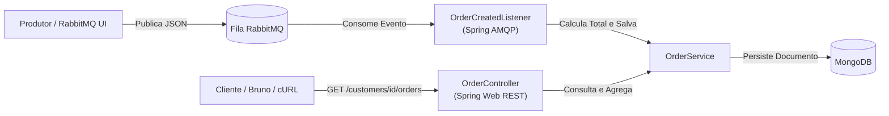

<h1 align="center">
  OrderMS Microsserviço de Processamento de Pedidos (Desafio BTG Pactual)
</h1>

<p align="center">
  
  
  
  
  
  
</p>

<p align="center">
  Microsserviço orientado a eventos para ingestão assíncrona de pedidos via <strong>RabbitMQ</strong>, persistência em <strong>MongoDB</strong> e exposição de relatórios analíticos via <strong>API REST</strong> em <strong>Java 21 e Spring Boot</strong>.
</p>

---

## Visão Geral

O **OrderMS** resolve o processamento assíncrono de alto volume transacional de pedidos em uma arquitetura desacoplada. Em vez de bloquear o produtor com escritas síncronas, os eventos de pedidos criados são enfileirados no **RabbitMQ**, consumidos pelo microsserviço Spring Boot, calculados com precisão monetária e armazenados no **MongoDB** para consulta rápida via **API REST**.

### Funcionalidades Entregues
* **Consumo Assíncrono (AMQP):** Escuta contínua de eventos de pedidos em fila dedicada no RabbitMQ com desserialização automática de payload JSON.
* **Cálculo e Persistência:** Cálculo do valor total do pedido no momento da ingestão e gravação estruturada no MongoDB.
* **API REST de Relatórios:** Endpoints para consulta de:
  * Valor total de cada pedido;
  * Quantidade total de pedidos realizados por cliente;
  * Lista paginada/detalhada de pedidos por cliente.
* **Enunciado Original:** Confira todos os requisitos do desafio em [problem.md](./problem.md).

---

## Arquitetura da Solução



---

## Stack Tecnológica e Decisões Técnicas

| Tecnologia | Versão / Ferramenta | Papel na Arquitetura |
| :--- | :--- | :--- |
| **Java** | 21 (LTS) | Linguagem principal com uso de Records para DTOs imutáveis |
| **Spring Boot** | 3.x | Framework base para injeção de dependências, Web REST e AMQP |
| **Spring AMQP** | RabbitMQ Starter | Consumo assíncrono de mensagens e conversão JSON (`Jackson2JsonMessageConverter`) |
| **Spring Data MongoDB** | MongoDB Driver | Persistência orientada a documentos, repositórios e agregações |
| **MongoDB** | 7.x | Banco NoSQL escolhido pela aderência nativa à estrutura aninhada de `itens` do pedido |
| **RabbitMQ** | 3.x (Management) | Message broker para desacoplamento e resiliência no processamento |
| **Docker & Compose** | Engine / Compose | Orquestração local reprodutível da infraestrutura (RabbitMQ + MongoDB) |
| **Bruno & Compass** | API Client / GUI | Coleção de requisições HTTP versionada no projeto e inspeção visual do banco |

### Principais Decisões Arquiteturais
* **Precisão Monetária (`BigDecimal`):** Todos os valores unitários (`preco`) e totais (`total`) são manipulados com `BigDecimal` para evitar erros de arredondamento de ponto flutuante (`Double`/`Float`).
* **Modelagem Orientada a Documentos:** Como os itens pertencem exclusivamente ao ciclo de vida de um pedido, a estrutura embutida no MongoDB elimina `JOINs` e acelera a leitura dos relatórios por cliente.
* **Indexação por `codigoCliente`:** O campo identificador do cliente é indexado na coleção para garantir baixa latência nas consultas e contagens por cliente.

---

## Modelagem de Dados (MongoDB)

Cada mensagem consumida da fila é transformada e armazenada na coleção `tb_orders` com a seguinte estrutura:

```json
{
  "_id": 1001,
  "customerId": 1,
  "total": 120.00,
  "items": [
    {
      "product": "lápis",
      "quantity": 100,
      "price": 1.10
    },
    {
      "product": "caderno",
      "quantity": 10,
      "price": 1.00
    }
  ]
}
```

---

## Como Executar o Projeto

### Pré-requisitos
* **Docker** e **Docker Compose** instalados
* **Java 21** e **Maven** (ou utilize o wrapper `./mvnw` incluso no repositório)

### Passo 1: Clonar o repositório
```bash
git clone https://github.com/josiasdev/orderms.git
cd orderms
```

### Passo 2: Subir a infraestrutura (RabbitMQ e MongoDB)
```bash
cp .env.example .env
# edite .env com credenciais locais antes de subir
docker compose up -d
```
> **Nota:** Caso utilize o arquivo dentro de uma subpasta (ex: `docker/docker-compose.yml`), execute `docker compose -f docker/docker-compose.yml up -d`.

### Passo 3: Iniciar a aplicação Spring Boot
Exporte as variáveis de ambiente definidas no `.env` (ou configure-as no seu ambiente) antes de iniciar:
```bash
export $(grep -v '^#' .env | xargs)
./mvnw spring-boot:run
```
A aplicação estará disponível em `http://localhost:8080`.

---

## Como Testar o Fluxo Completo

### 1. Publicar um Pedido no RabbitMQ
1. Acesse o painel do RabbitMQ em `http://localhost:15672` (use as credenciais definidas no seu `.env` / `docker-compose.yml`; padrão local do RabbitMQ: `guest` / `guest`, salvo alteração).
2. Navegue até a aba **Queues and Streams** e selecione a fila configurada na aplicação (ex: `btg-pactual-order-created`).
3. Em **Publish message**, cole o payload abaixo e clique em **Publish message**:

```json
{
  "codigoPedido": 1001,
  "codigoCliente": 1,
  "itens": [
    {
      "produto": "lápis",
      "quantidade": 100,
      "preco": 1.10
    },
    {
      "produto": "caderno",
      "quantidade": 10,
      "preco": 1.00
    }
  ]
}
```

### 2. Consultar os Relatórios via API REST
Você pode importar a coleção do **Bruno** disponível no repositório ou executar diretamente via `cURL`:

```bash
curl -X GET "http://localhost:8080/customers/1/orders" \
  -H "Accept: application/json"
```

**Exemplo de Resposta (`200 OK`):**
```json
{
  "summary": {
    "totalOnOrders": 120.00
  },
  "orders": {
    "content": [
      {
        "orderId": 1001,
        "customerId": 1,
        "total": 120.00
      }
    ],
    "page": 0,
    "pageSize": 10,
    "totalElements": 1,
    "totalPages": 1
  }
}
```

### 3. Inspecionar o Banco no MongoDB Compass
Conecte-se usando as credenciais configuradas no `.env`/`application.properties` (ex.: `mongodb://<usuario>:<senha>@localhost:27017`) para visualizar os documentos persistidos em tempo real.

---

## Plano de Trabalho e Entregáveis (Previsto vs. Realizado)

| Etapa / Task | Estimativa | Realizado | Status |
| :--- | :---: | :---: | :---: |
| 1. Análise de requisitos e elaboração do plano de trabalho | 2h | 2h | Concluído |
| 2. Configuração do ambiente Docker (RabbitMQ + MongoDB) | 2h | 1h30 | Concluído |
| 3. Modelagem da entidade e configuração do Spring Data MongoDB | 2h | 2h | Concluído |
| 4. Implementação do Consumer RabbitMQ e cálculo de totais | 4h | 3h30 | Concluído |
| 5. Desenvolvimento da API REST e consultas agregadas por cliente | 4h | 4h | Concluído |
| 6. Testes funcionais (Bruno + RabbitMQ UI) e documentação | 3h | 2h30 | Concluído |
| **Total** | **17h** | **15h30** | **100% Entregue** |

---

## Autor

**Francisco Josias da Silva Batista**  
Graduando em Engenharia de Software Universidade Federal do Ceará (UFC)  
* **GitHub:** [github.com/josiasdev](https://github.com/josiasdev)
* **LinkedIn:** [linkedin.com/in/josias-batista](https://www.linkedin.com/in/josias-batista/)
* **Portfólio:** [josias-batista-portfolio.vercel.app](https://josias-batista-portfolio.vercel.app)
